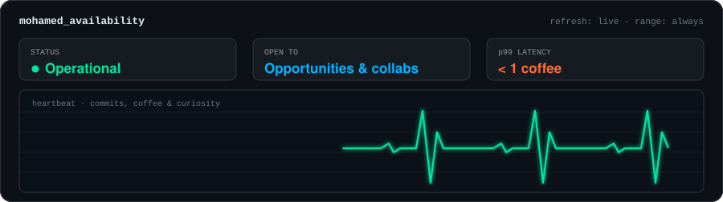

 

## `> cat about.md`

I'm a Software Engineering student at the **National Institute of Posts and Telecommunications (INPT), Rabat, Morocco**, passionate about backend engineering, distributed systems, and building reliable software solutions.

- Backend development with **Java, Spring Boot, and REST APIs**
- Interested in distributed systems, event-driven architecture, and system reliability
- Exploring cloud-native technologies, containerization, and DevOps
- Building AI-assisted applications and intelligent backend systems

## 🔭 My profile, as a distributed trace

<b>🔍 Expand span details (projects)</b>

 

**🔍 Intelligent Microservices Debugging Platform**
Distributed observability combined with AI-assisted root-cause analysis: logs, metrics, and traces from microservices, anomaly detection, Kafka-based event processing, and LLM + RAG explanations.
`Java` `Spring Boot` `Spring Cloud` `Kafka` `OpenTelemetry` `Prometheus` `Grafana` `Kubernetes` `Spring AI`

**☁️ Cloud FinOps Platform**
Cloud cost visibility and optimization: Spring Boot backend with JWT auth and RBAC, a cost-analysis dashboard, and AI-assisted recommendations.
`Java` `Spring Boot` `Spring Security` `PostgreSQL` `React` `Docker` `Jenkins`

**⚡ Real-Time Medical Dispatch Engine**
Internship backend exploring intelligent matching between healthcare requests and professionals using simulated data: queue-based processing, availability matching, semantic matching with embeddings and vector search, and monitoring.
`Java 21` `Spring Boot` `Python` `FastAPI` `Redis` `PostgreSQL` `pgvector` `Sentence Transformers` `Prometheus` `Grafana`

## ☸️ My stack, as `kubectl get pods -A`

## 🏅 Certifications

## 📈 Dashboard

<picture>
  <source media="(prefers-color-scheme: dark)" srcset="https://raw.githubusercontent.com/Boutamment/Boutamment/output/github-snake-dark.svg"/>
  <source media="(prefers-color-scheme: light)" srcset="https://raw.githubusercontent.com/Boutamment/Boutamment/output/github-snake.svg"/>
  
</picture>

## 🩺 Health check

 

I'm interested in software engineering opportunities and discussions about backend architecture, distributed systems, cloud technologies, and AI-driven applications.

 

*Building, learning, and improving — one system at a time.*

