 

## `> cat about.md`

I'm a Software Engineering student at the **National Institute of Posts and Telecommunications (INPT), Rabat, Morocco**, passionate about backend engineering, distributed systems, and building reliable software solutions.

- Backend development with **Java, Spring Boot, and REST APIs**
- Interested in distributed systems, event-driven architecture, and system reliability
- Exploring cloud-native technologies, containerization, and DevOps
- Building AI-assisted applications and intelligent backend systems

## 🧱 Tech Stack

## ⚡ Technologies

 

## 🏅 Certifications

## 📈 Dashboard

<picture>
  <source media="(prefers-color-scheme: dark)" srcset="https://raw.githubusercontent.com/Boutamment/Boutamment/output/github-snake-dark.svg?v=2"/>
  <source media="(prefers-color-scheme: light)" srcset="https://raw.githubusercontent.com/Boutamment/Boutamment/output/github-snake.svg?v=2"/>
  
</picture>

## 🩺 Health check

 

I'm interested in software engineering opportunities and discussions about backend architecture, distributed systems, cloud technologies, and AI-driven applications.

 

*Building, learning, and improving — one system at a time.*

